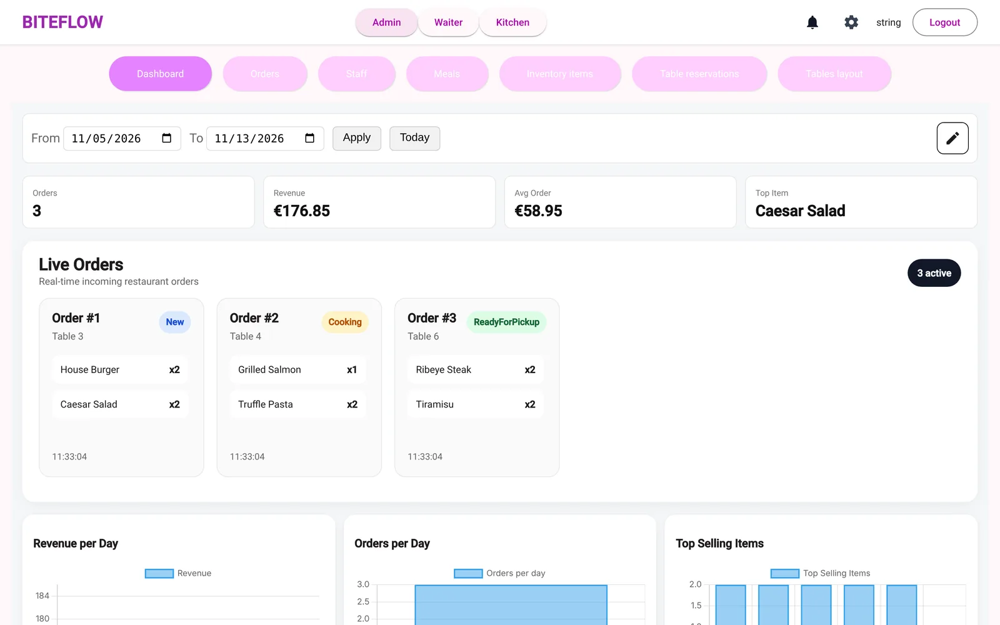
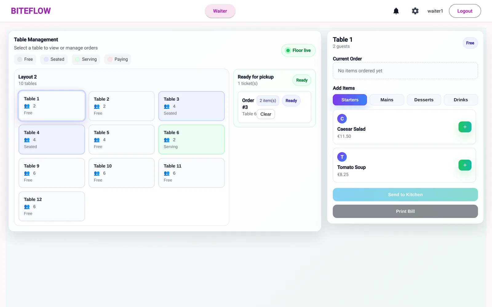
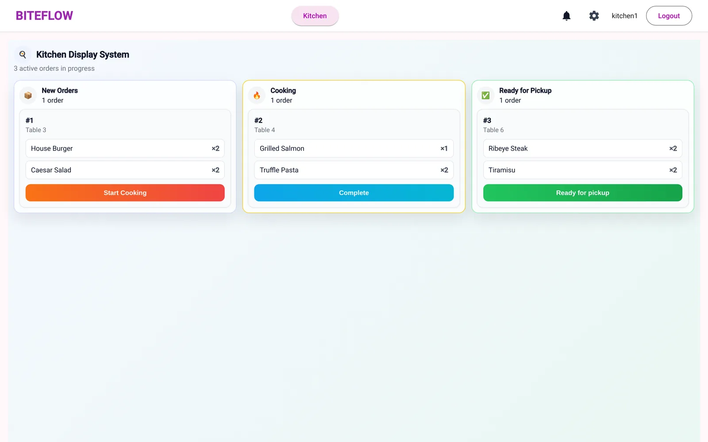
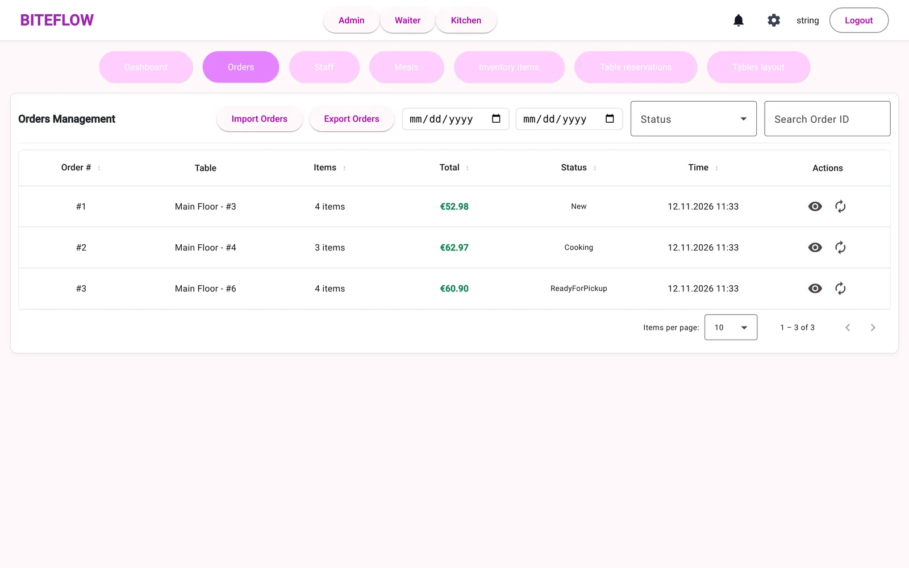
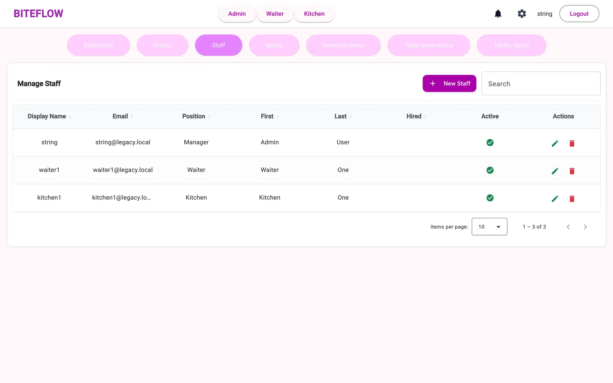
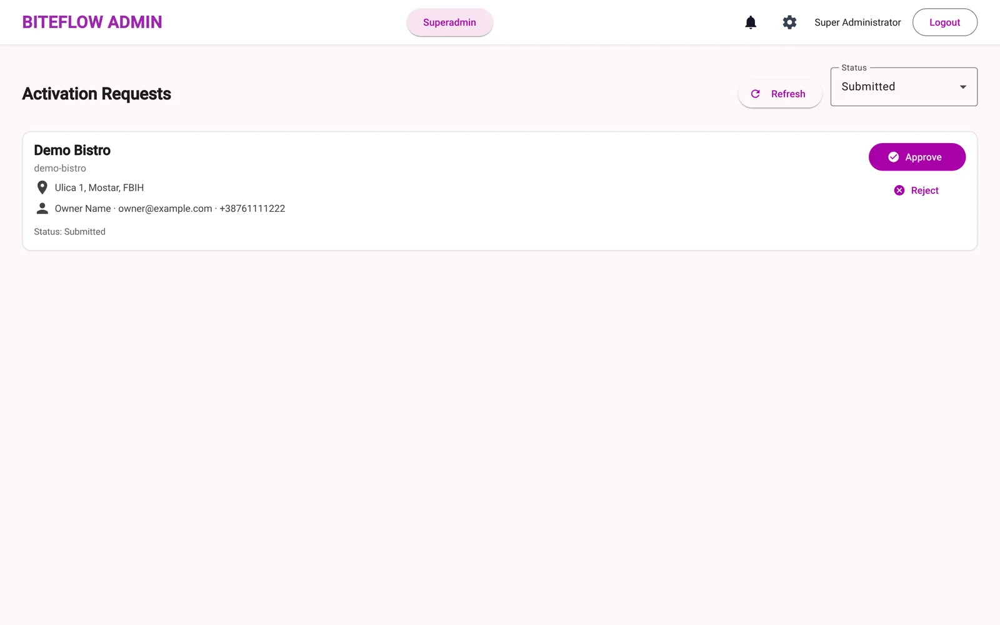
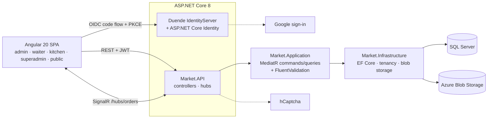

# Biteflow


**A multi-tenant restaurant management platform.** Restaurants apply to join and a superadmin approves them. Each
restaurant then runs its menu, inventory, staff, tables, reservations and orders from an admin area. **Waiter and
kitchen screens update in real time** as orders move from *New* to *Cooking* to *Ready for pickup*. Built with
**Angular 20** and an **ASP.NET Core 8** API that also hosts **Duende IdentityServer**.

Team project (2 developers, 2025–2026) by [Anur Zjakić](https://github.com/AnurZ) and
[Mensur Čavak](https://github.com/Menso1310) · [Portfolio](https://anurz.github.io/portfolio/)

> This GitHub repository is a mirror. Development happened on Azure DevOps with an issue tracker, feature branches
> and pull requests.

---

## Screenshots

Taken from the running app with the seeded demo data.

| Admin dashboard: KPIs, live orders, analytics | Waiter: tables and order entry |
|---|---|
|  |  |
| **Kitchen display (real-time via SignalR)** | **Orders management** |
|  |  |
| **Staff management** | **Superadmin: restaurant activation requests** |
|  |  |

## Features

| Role | What they can do |
|---|---|
| **Superadmin** | Review restaurant activation requests and approve or reject them |
| **Admin** (restaurant owner/manager) | Dashboard with KPIs, live orders and charts · staff · meals and categories · inventory · dining tables, table layout and reservations · orders, including CSV/Excel import and export |
| **Waiter** | See the floor plan with table status, take orders, send them to the kitchen, print the bill |
| **Kitchen** | Kitchen display with *New → Cooking → Ready for pickup* columns that update live |
| **Customer** | Browse the public storefront, register, request a table reservation |

## Architecture



```
Backend/
  Market.API             controllers, SignalR hubs, IdentityServer config, Razor login pages
  Market.Application     CQRS modules (MediatR), validators, validation pipeline behaviour
  Market.Domain          entities and domain model
  Market.Infrastructure  EF Core contexts, migrations, seeders, tenancy, blob storage
  Market.Shared          shared constants and helpers
  Market.Tests           xUnit unit + API integration tests
Frontend/
  src/app/modules        admin, waiter, kitchen, superadmin, public, meals, inventory-items,
                         table-layout, table-reservation, settings, core, shared
```

## Engineering highlights

- **Single sign-on with IdentityServer.** The API hosts Duende IdentityServer on top of ASP.NET Core Identity. The
  Angular app signs in with the **OIDC authorization-code flow + PKCE**, with a Razor login page, **Google sign-in**
  and **hCaptcha**.
- **Multi-tenancy.** Each restaurant is a tenant. **Global EF Core query filters** scope every query to the current
  tenant, and new restaurants go through an activation workflow with signed, time-limited activation links.
- **CQRS.** Features are MediatR commands and queries, and a **FluentValidation** pipeline behaviour validates every
  request before it reaches a handler.
- **Real time.** A **SignalR** orders hub pushes order changes to the waiter, kitchen and admin screens without
  reloading.
- **Files.** Images are resized with ImageSharp, stored in **Azure Blob Storage** and served through short-lived SAS
  URLs.
- **Testing and logging.** There are **107 xUnit tests** (unit + API integration via `WebApplicationFactory`) covering
  auth, orders, inventory, meals, table reservations and notifications. Serilog structured logging and request
  logging middleware flag slow requests.
- **CI.** An Azure Pipelines build blocks hard-coded backend URLs in the frontend and mirrors the repo to GitHub.

## My contributions (Anur)

I wrote about 70% of the non-merge commits. My work covered:

- **Authentication end-to-end:** moved the app from plain JWT to ASP.NET Core Identity + Duende IdentityServer (OIDC
  code flow with PKCE for Angular), plus Google sign-in and hCaptcha
- **Restaurant onboarding:** activation requests, superadmin approval and the setup wizard
- **Tenant isolation** with global EF Core query filters
- **The admin CRUD screens and APIs:** staff, orders, inventory and table reservations
- **The waiter and kitchen screens** with real-time order updates over SignalR, and the analytics dashboard
- **A security pass:** closed ownership/authorization gaps, centralized the password policy, added regression tests

Mensur built the public storefront, meals management and the table-layout editor.

## Tech stack

| Area | Technologies |
|---|---|
| Frontend | Angular 20, TypeScript, RxJS, Angular Material, Reactive Forms, angular-oauth2-oidc, @microsoft/signalr, Chart.js |
| Backend | ASP.NET Core 8 Web API, EF Core, SQL Server, MediatR, FluentValidation, SignalR, Serilog, Swagger |
| Identity | ASP.NET Core Identity, Duende IdentityServer, Google sign-in, hCaptcha |
| Files & data | Azure Blob Storage, ImageSharp, CsvHelper, ClosedXML |
| Testing & CI | xUnit, Microsoft.AspNetCore.Mvc.Testing, Azure Pipelines |

---

## Getting started

### 1. Infrastructure

SQL Server and Azure Blob Storage are needed. Locally you can run both in Docker; Azurite emulates Blob Storage:

```bash
docker run -d --name biteflow-sql -e ACCEPT_EULA=Y -e MSSQL_SA_PASSWORD='Your_strong_pass1!' -p 1433:1433 mcr.microsoft.com/mssql/server:2022-latest
docker run -d --name biteflow-azurite -p 10000:10000 mcr.microsoft.com/azure-storage/azurite azurite-blob --blobHost 0.0.0.0
```

### 2. Backend (API + IdentityServer)

Set these with user secrets or environment variables:

```text
ConnectionStrings__Main                  SQL Server connection string
ActivationLink__TokenSecret              any long random string
AzureBlobStorage__ConnectionString       e.g. the Azurite connection string
AzureBlobStorage__ContainerName          e.g. biteflow
Authentication__Google__ClientId         Google OAuth client (placeholder values work if you don't use Google sign-in)
Authentication__Google__ClientSecret
Captcha__SecretKey                       hCaptcha secret, or set Captcha__Enabled=false locally
```

Then run the API over HTTPS. The auth cookies are `Secure`, so HTTP won't work:

```bash
dotnet dev-certs https --trust                                  # once, to trust the local HTTPS certificate
dotnet run --project Backend/Market.API --launch-profile https   # https://localhost:7260, Swagger at /swagger
```

In `Development` the API applies migrations and seeds demo data on startup.

### 3. Frontend

```bash
cd Frontend
npm install
npm start          # http://localhost:4200
```

### 4. Tests

```bash
dotnet test Backend/Market.Tests/Market.Tests.csproj
```

## Demo accounts (seeded in Development)

| Role | Username | Password |
|---|---|---|
| Superadmin | `superadmin` | `Superadmin1!` |
| Restaurant admin | `string` | `StringUser1!` |
| Waiter | `waiter1` | `WaiterUser1!` |
| Kitchen | `kitchen1` | `KitchenUser1!` |
